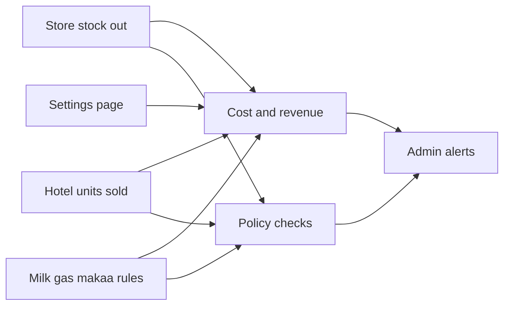

# Jarvis assistant

Living notes for how hotel sales and store use become cost, revenue, and profit. Edit a plan in place when a rule changes. The project setup guide stays in [README.md](README.md).

The question underneath all three plans is how much money was spent to produce a given amount of revenue.

## Plan 1 — Inputs and profit patterns

Each cost line has one category and one data source. The October workbook’s duplicated rows are dropped.

Cooking fat is Snacks only. It is not copied onto the food sheet. Sugar is Drinks only. It is not copied onto the food sheet.

Revenue for snacks and drinks is computed in [backend/db/analytics.py](backend/db/analytics.py):

- Sold = previous closing + added − closing. Previous closing is yesterday’s saved entry only.
- Revenue = sold × the selling price on `item_prices` for that day.

Food and kuku revenue is plates on `food_kuku_daily` × that selling price. Selling price and purchase price are different numbers. Selling prices stay on the Prices page at [frontend/app/admin/prices/page.tsx](frontend/app/admin/prices/page.tsx). Purchase prices live on the Stock Items settings dashboard.

Cost depends on the data source stored for that item:

| Data source | Cost | Used for |
|---|---|---|
| `hotel_sold` | Units sold × purchase price | Predator, Soda, Minute Maid, Dasani 1 ltr, Dasani 500 ml, Lemonade, Water 1 ltr, Water 500 ml |
| `store_stock_out` | Kitchen or Hotel stock out × purchase price, from the Google Sheet `Transactions` tab (`out` to Kitchen or Hotel) | Kitchen ingredients that are not a counted drink sale: maize flour, rice, meat, kuku heads, oil, vegetables, cooking fat, sugar, eggs, and the rest of that list |
| `recipe_milk` | Liters × milk purchase price | Milk only. Liters = Tea cups sold / 6 + white coffee cups sold / 3 |
| `policy_rate` | The rate, not the raw stock-out figure | Gas and makaa |

Water 1 ltr and Water 500 ml use `hotel_sold` because the spend that produced the revenue is the bottles sold, not every bottle issued. A separate check requires store stock out to Kitchen or Hotel to equal the drinks clerk’s Add for that hotel item on the same day. Sold can differ from Add, because sold is previous closing + Add − closing.

Milk is not taken from the store log. Tea is the item named Tea. White coffee is the item named WhiteCofee. LemonTea, BlackCoffee, and Lemonade do not add milk.

Gas: one cylinder is 9,000 for a calendar month, so one day is 9,000 divided by the number of days in that month. Makaa: 3 bags per week, so one day is 3/7 bags × the bag purchase price. Profit uses these rates. Actual stock out is the check, not a second cost line.

Lemonade is its own drinks row, selling price 60, beside LemonTea at 30. It is not in the seed list in [backend/core/catalog.py](backend/core/catalog.py); it was added on the Prices page. The October analysis row named Lemonade (purchase price 35) is this item. Data source `hotel_sold`. It is not an alias of LemonTea or Concusion.

Policy alerts go to admin when recorded stock out does not meet the rule:

- Gas: recorded usage for the month is not one cylinder.
- Makaa: recorded stock out for the week is not 3 bags.
- Water 1 ltr and Water 500 ml: store stock out does not equal hotel Add.
- A cost line appears on two categories.

Rooms and Hotel lines (soap, Omo, toilet paper, serviettes) stay out of this profit. Bar stays out until a later tuning. Dish labels in [backend/core/dish_rules.py](backend/core/dish_rules.py) (ugali, rice, matumbo, kuku, mix, fries, managu) stay plate counts only, because one plate can match several labels and their revenues overlap.

The settings dashboard replaces the old Stock Items entry screen. The route stays `/stock-items` and the nav label stays Stock Items. Daily closing and added fields are no longer on this page. Store movement stays in the store log. The admin Stock Catalog at `/admin/stock-items` stays the raw-name list.

Each row on the dashboard has:

- Item name
- Category: Snacks, Drinks, Food, or Kuku
- Data source: `hotel_sold`, `store_stock_out`, `recipe_milk`, or `policy_rate`
- Purchase unit price
- Hotel item to read sold or added from, when the source needs it
- Store item to read stock out from, when the source or the water check needs it
- Rate inputs where needed: tea cups per liter, white coffee cups per liter, bags per week, cylinder cost per month

Admin and stock clerk can open the page. Edits are admin-only. A stock clerk can read the rows.

### Open tuning

- Whether Plastic Soda shares the Soda purchase line or needs its own row.
- Tea leaves purchase price: the store master has 200 and the October sheet used 100. The seeded row uses 200 and can be edited.
- Whether stock out to Mum, House Keeping, Order, or Error is excluded from store cost. Kitchen and Hotel stock out are the cost quantity. The other destinations are reported beside it.
- Bar is still outside these profit buckets.

## Plan 2 — Daily, weekly, and monthly reports

Three report shapes reuse the Plan 1 formulas. Dates are the hotel’s local calendar dates, Africa/Nairobi for store timestamps.

The live screen is [frontend/app/admin/cost-profit/page.tsx](frontend/app/admin/cost-profit/page.tsx), admin only, at `/admin/cost-profit`. It calls `GET /api/cost-report?date_from=&date_to=`. Presets fill Yesterday, the Monday–Sunday week that contains yesterday, and that calendar month. From and To stay editable for any other range. The same formulas apply. A week that crosses a month still splits gas on the month boundary, and makaa still checks each Monday–Sunday week the range touches.

The store is a Google Sheet, not a Neon database. Do not point `STORE_DATABASE_URL` at the sheet. [backend/db/store.py](backend/db/store.py) reads it with `GOOGLE_SHEETS_SPREADSHEET_ID` (the id in the sheet URL) and `GOOGLE_SERVICE_ACCOUNT_JSON`. That value can be the full service-account JSON, or only the private key when `GOOGLE_SERVICE_ACCOUNT_EMAIL` is set. The sheet is shared with that account as a Viewer.

Tab `Transactions` is the movement log. Column A is the timestamp in UTC; convert it to Africa/Nairobi before the calendar date. Column C is the item name, matched to `store_item_name`. Column D is the type: `out` is usage and `in` is a delivery. Column E is the quantity. Column H is the destination. `Kitchen` and `Hotel` are the cost quantity. `Order` and the other destinations stay beside the line and are left out of cost. Cost quantity is Transactions `out` to Kitchen or Hotel. The Corrections tab is not part of this read.

Tab `Sheet1` is the item master. Column B fills the store-item list. Column K is the suggested purchase price. Column G, lifetime stock out, is not the cost for a date range.

If the sheet env is missing or the Sheets call fails, sales still return and store-based cost stays waiting. Saved report revisions are not built yet.

Daily report, for the previous business day:

- Sales by snacks, drinks, food, and kuku, plus item lines when that day’s hotel entry is in.
- Cost and profit for lines whose required source is present.
- If the store is behind, the note still shows sales and marks store-based cost as waiting.
- Water checks for that day, and the day’s share of gas (9,000 / days in the month) and makaa (3/7 bags).

Weekly report, Monday–Sunday:

- The same four sales groups.
- Gas is the month rate × 7 / days in that month.
- Makaa is 3 bags unless the settings rate changes.
- Policy alerts: makaa stock out for the week is not 3 bags, and any day where water store stock out did not match hotel Add.

Monthly report, calendar month:

- Gas for the month is 9,000 unless the settings cylinder cost changes.
- Days that were still incomplete or revised.
- Gas and makaa alerts for that month.

Each report has a status. It is preliminary while any required source for that window is missing. It is final when every included day is filled. A later correction issues a revision of that same report rather than overwriting the earlier copy silently.

The first place a report is read is the Cost & profit admin screen. The figures are computed when the page opens. Email or WhatsApp delivery is not decided yet. A later correction still does not overwrite a saved copy, because copies are not stored yet.

### Open tuning

- Delivery channel after the admin screen: email, WhatsApp, or both.
- Whether a week that crosses a month boundary splits the gas accrual on the month boundary. The starting rule does: each day uses that month’s daily share.

## Plan 3 — Late fills and corrections

A source can sit empty for several days and still land in the right period.

Completeness is per day and per source: snacks and drinks close, food and kuku quantities, and store transactions. A missing source does not block the sources that are already in. Sales can publish while cost waits.

Hotel days can be finalized through the locks in [backend/migrations/005_food_kuku_day_lock.sql](backend/migrations/005_food_kuku_day_lock.sql) and the snacks and drinks lock. A lock means the clerk is done, not that the profit figure is frozen. An admin correction after lock still recomputes that day.

The live store log is the `Transactions` tab. A period rebuild reads those rows for the dates they belong to. The Corrections tab is not added into the period until that read is decided. The item’s category on the settings dashboard decides which profit bucket moves.

When a late day arrives, rebuild every report whose window contains that day: that day’s daily, that week, and that month. Mark the new copy as a revision with the reason, late fill or correction.

Do not treat the lifetime totals on the store item sheet as a two-week report. Opening for a range is the balance just before the start date. Small gaps between the transaction log and the item-sheet totals stay visible as a reconciliation note.

### Open tuning

- How many days a source may lag before a daily report stays preliminary instead of being sent with cost marked waiting.
- Whether a correction after a day lock must carry a written reason before the revision is issued.
